### Journal articles

::: {.publication}
::: {.pub-year}
2026 · In press
:::

#### What is People’s Ideal Number of Children and do They Achieve It?

**Plach, S.**, A. Aassve, L. Mencarini.

*Demographic Research*.
:::

::: {.publication}
::: {.pub-year}
2026 · In press
:::

#### Beyond Spending: Governance Quality and Citizens’ Perceptions of Public Institutions as Drivers of Individual Resilience

**Plach, S.**, A. Aassve.

*Journal of International and Comparative Social Policy*.
:::

::: {.publication}
::: {.pub-year}
2026
:::

#### [Fertility Dynamics across High-Income Countries in a New Era of Polycrisis](https://doi.org/10.1111/padr.70091)

**Plach, S.**, A. Aassve, N. Cavalli, M. Valetto.

*Population and Development Review, 52: 872–907*.

Abstract

The COVID-19 pandemic opened a polycrisis of interrelated disruptions and compounding economic and subjective uncertainty that likely shaped fertility in high-income countries, especially in its second phase, in which the Ukraine war was a major source and amplifier of uncertainty. Yet fertility evidence remains largely limited to the pandemic. We estimate monthly “excess” total fertility rates (TFRs) and find that declines compared to projected pre-polycrisis trends were short-lived during the first phase and excess TFRs overall positive in all 26 sample countries except Eastern Europe and Portugal. Instead, during the second phase, excess TFRs are strongly and increasingly negative in Eastern and Central Europe, Greece, Portugal, France, Denmark, and Sweden. Investigating potential explanatory variables, we find that the total, energy, and housing consumer price indices and reversed consumer confidence are negatively associated with excess TFRs, especially in Eastern and Central Europe, Greece, France, Denmark, and Sweden. Refugee inflows, the economic policy uncertainty index, and the geopolitical risk index show weaker negative associations. But country heterogeneity is large. Our analysis suggests that fertility dynamics are closely linked to the polycrisis, citizens’ economic conditions and confidence are the strongest correlates, and extensive welfare regimes alone may not consistently sustain fertility under accumulating uncertainty.

[Source](https://doi.org/10.1111/padr.70091)

<figure class="media-card paper-visual" id="polycrisis-figure-1">
<figcaption class="visual-title">Figure 1. Total fertility rates (TFRs) relative to the mean in the 5 years before the pandemic (1/3)</figcaption>
<a class="enlarge-image" href="assets/papers/polycrisis/figure-1.png" data-caption="Figure 1. Total fertility rates (TFRs) relative to the mean in the 5 years before the pandemic (1/3)" aria-label="Enlarge: Figure 1. Total fertility rates (TFRs) relative to the mean in the 5 years before the pandemic (1/3)">
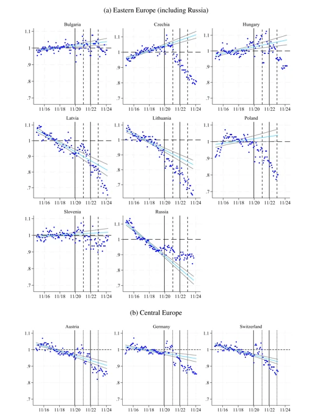
Enlarge ↗
</a>

NOTES: Plots show TFRs as a ratio to the mean in the five years before the polycrisis (November 2015 to October 2020, taking into account a nine-month shift). Vertical solid lines are the pandemic and Ukraine war cutoffs shifted by nine months to refer to births rather than conceptions (November 2020 and November 2022). Vertical dashed line split the pandemic into, respectively, before and after mass vaccination campaigns started and first and onward years of war. Trends are estimated linearly based on five years of pre-pandemic data, which are also plotted. Excess TFRs used in later analyses are the difference between actual TFRs and the trend as a ratio to the trend, that is, the percentage deviation of TFRs from the trend, which in the plots is simply the difference between dots and line, as values are displayed in relative terms already. Y-axis scales vary slightly for Latvia and Lithuania and later for Finland for illustrative purposes. Russia is reported here for completeness but excluded in any analysis below.

<a class="media-source" href="https://doi.org/10.1111/padr.70091" target="_blank" rel="noopener noreferrer">Source</a>
</figure>
<figure class="media-card paper-visual" id="polycrisis-figure-2">
<figcaption class="visual-title">Figure 2. Total fertility rates (TFRs) relative to the mean in the 5 years before the pandemic (2/3)</figcaption>
<a class="enlarge-image" href="assets/papers/polycrisis/figure-2.png" data-caption="Figure 2. Total fertility rates (TFRs) relative to the mean in the 5 years before the pandemic (2/3)" aria-label="Enlarge: Figure 2. Total fertility rates (TFRs) relative to the mean in the 5 years before the pandemic (2/3)">
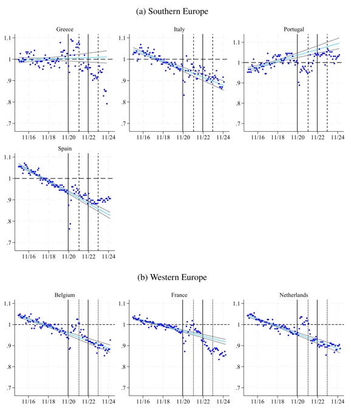
Enlarge ↗
</a>
<a class="media-source" href="https://doi.org/10.1111/padr.70091" target="_blank" rel="noopener noreferrer">Source</a>
</figure>
<figure class="media-card paper-visual" id="polycrisis-figure-3">
<figcaption class="visual-title">Figure 3. Total fertility rates (TFRs) relative to the mean in the 5 years before the pandemic (3/3)</figcaption>
<a class="enlarge-image" href="assets/papers/polycrisis/figure-3.png" data-caption="Figure 3. Total fertility rates (TFRs) relative to the mean in the 5 years before the pandemic (3/3)" aria-label="Enlarge: Figure 3. Total fertility rates (TFRs) relative to the mean in the 5 years before the pandemic (3/3)">
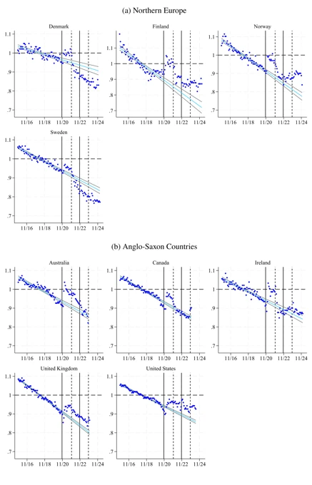
Enlarge ↗
</a>
<a class="media-source" href="https://doi.org/10.1111/padr.70091" target="_blank" rel="noopener noreferrer">Source</a>
</figure>
<figure class="media-card paper-visual" id="polycrisis-table-1">
<figcaption class="visual-title">Table 1. Mean monthly excess TFRs during the pandemic and second polycrisis phase and the overall polycrisis</figcaption>
<a class="enlarge-image" href="assets/papers/polycrisis/table-1.png" data-caption="Table 1. Mean monthly excess TFRs during the pandemic and second polycrisis phase and the overall polycrisis" aria-label="Enlarge: Table 1. Mean monthly excess TFRs during the pandemic and second polycrisis phase and the overall polycrisis">
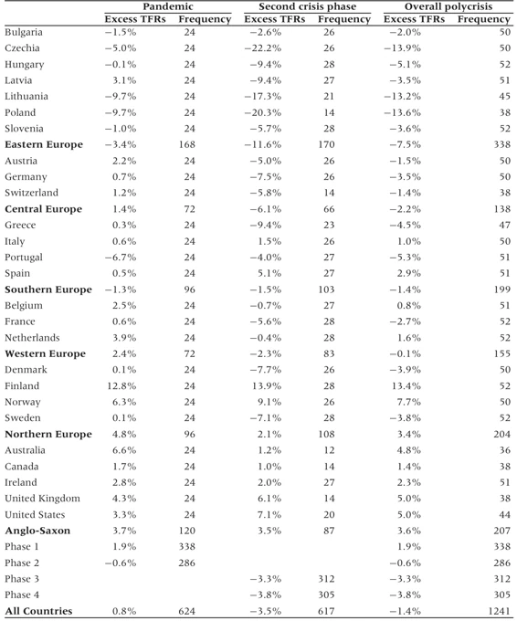
Enlarge ↗
</a>

NOTE: Mean monthly excess TFR means for all countries pooled and by country-groups are weighted by country-months of available live birth data during the respective period.

<a class="media-source" href="https://doi.org/10.1111/padr.70091" target="_blank" rel="noopener noreferrer">Source</a>
</figure>
<figure class="media-card paper-visual" id="polycrisis-figure-4">
<figcaption class="visual-title">Figure 4. Polycrisis explanatory variables during two pre-polycrisis years and during the polycrisis.</figcaption>
<a class="enlarge-image" href="assets/papers/polycrisis/figure-4.png" data-caption="Figure 4. Polycrisis explanatory variables during two pre-polycrisis years and during the polycrisis." aria-label="Enlarge: Figure 4. Polycrisis explanatory variables during two pre-polycrisis years and during the polycrisis.">
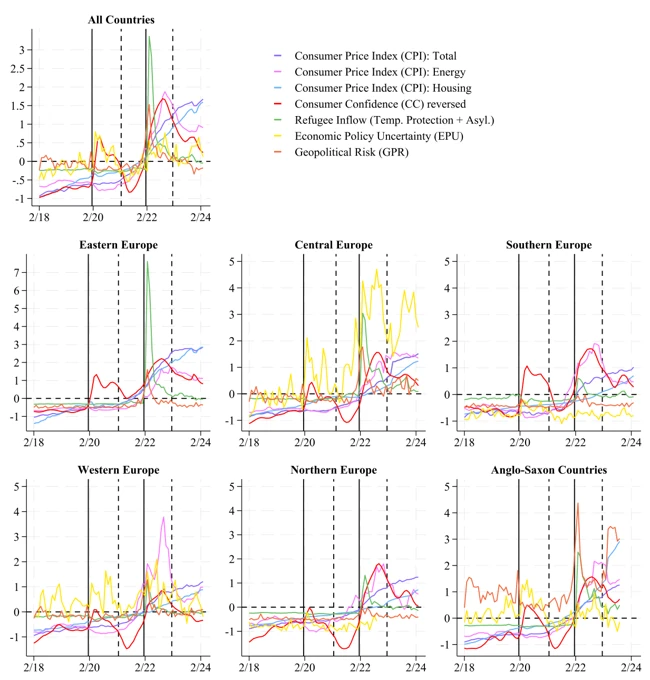
Enlarge ↗
</a>

NOTES: Only countries with observed TFRs are included in the means. Trends are cut off at March 2024, which matches births in December 2024, because most countries (18 of 26) are observed until then. For the Anglo-Saxon countries, trends are already cut off in September 2023, which matches births in June 2024, because at least two of five countries are observed until then. Russia is excluded. The plots for the pooled sample and for the Eastern European countries are on different scales for illustrative purposes.

<a class="media-source" href="https://doi.org/10.1111/padr.70091" target="_blank" rel="noopener noreferrer">Source</a>
</figure>
<figure class="media-card paper-visual" id="polycrisis-figure-5">
<figcaption class="visual-title">Figure 5. Association of total CPI with excess TFRs during the COVID-19 pandemic and second polycrisis phase</figcaption>
<a class="enlarge-image" href="assets/papers/polycrisis/figure-5.png" data-caption="Figure 5. Association of total CPI with excess TFRs during the COVID-19 pandemic and second polycrisis phase" aria-label="Enlarge: Figure 5. Association of total CPI with excess TFRs during the COVID-19 pandemic and second polycrisis phase">
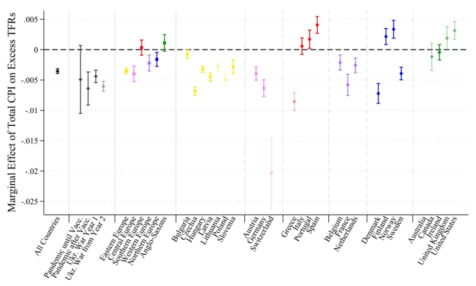
Enlarge ↗
</a>

NOTES: Coefficients can be interpreted as TFR relative to the estimated trend. Russia is not included. Data availability varies slightly across countries: 36 months for Australia; 38 months for Poland, Switzerland, Canada, United Kingdom; 44 months for the United States; 45 months for Lithuania; 47 months for Greece; and 50–52 months for other countries. Countries with less than 50 months of data are distinguished by more transparent colors. Ninety-five percent confidence intervals are shown.

<a class="media-source" href="https://doi.org/10.1111/padr.70091" target="_blank" rel="noopener noreferrer">Source</a>
</figure>
<figure class="media-card paper-visual" id="polycrisis-figure-6">
<figcaption class="visual-title">Figure 6. Association of energy CPI with excess TFRs during the COVID-19 pandemic and second polycrisis phase</figcaption>
<a class="enlarge-image" href="assets/papers/polycrisis/figure-6.png" data-caption="Figure 6. Association of energy CPI with excess TFRs during the COVID-19 pandemic and second polycrisis phase" aria-label="Enlarge: Figure 6. Association of energy CPI with excess TFRs during the COVID-19 pandemic and second polycrisis phase">
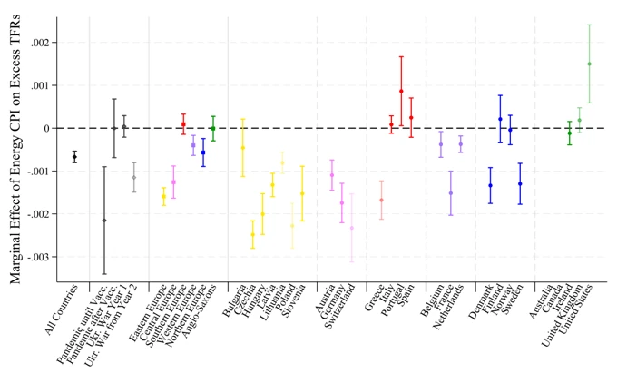
Enlarge ↗
</a>
<a class="media-source" href="https://doi.org/10.1111/padr.70091" target="_blank" rel="noopener noreferrer">Source</a>
</figure>
<figure class="media-card paper-visual" id="polycrisis-figure-7">
<figcaption class="visual-title">Figure 7. Association of housing CPI with excess TFRs during the COVID-19 pandemic and second polycrisis phase</figcaption>
<a class="enlarge-image" href="assets/papers/polycrisis/figure-7.png" data-caption="Figure 7. Association of housing CPI with excess TFRs during the COVID-19 pandemic and second polycrisis phase" aria-label="Enlarge: Figure 7. Association of housing CPI with excess TFRs during the COVID-19 pandemic and second polycrisis phase">
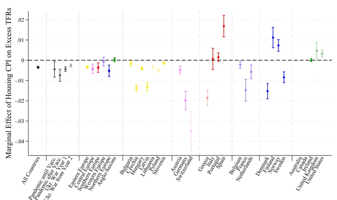
Enlarge ↗
</a>
<a class="media-source" href="https://doi.org/10.1111/padr.70091" target="_blank" rel="noopener noreferrer">Source</a>
</figure>
<figure class="media-card paper-visual" id="polycrisis-figure-8">
<figcaption class="visual-title">Figure 8. Association of reversed consumer confidence (CC) with excess TFRs during the COVID-19 pandemic and second polycrisis phase</figcaption>
<a class="enlarge-image" href="assets/papers/polycrisis/figure-8.png" data-caption="Figure 8. Association of reversed consumer confidence (CC) with excess TFRs during the COVID-19 pandemic and second polycrisis phase" aria-label="Enlarge: Figure 8. Association of reversed consumer confidence (CC) with excess TFRs during the COVID-19 pandemic and second polycrisis phase">
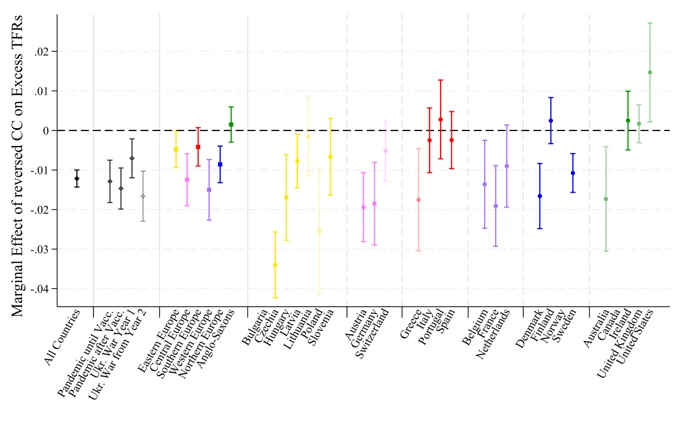
Enlarge ↗
</a>
<a class="media-source" href="https://doi.org/10.1111/padr.70091" target="_blank" rel="noopener noreferrer">Source</a>
</figure>
<figure class="media-card paper-visual" id="polycrisis-figure-9">
<figcaption class="visual-title">Figure 9. Association of refugee inflow (temporary protection and asylum) with excess TFRs during the COVID-19 pandemic and second polycrisis phase</figcaption>
<a class="enlarge-image" href="assets/papers/polycrisis/figure-9.png" data-caption="Figure 9. Association of refugee inflow (temporary protection and asylum) with excess TFRs during the COVID-19 pandemic and second polycrisis phase" aria-label="Enlarge: Figure 9. Association of refugee inflow (temporary protection and asylum) with excess TFRs during the COVID-19 pandemic and second polycrisis phase">
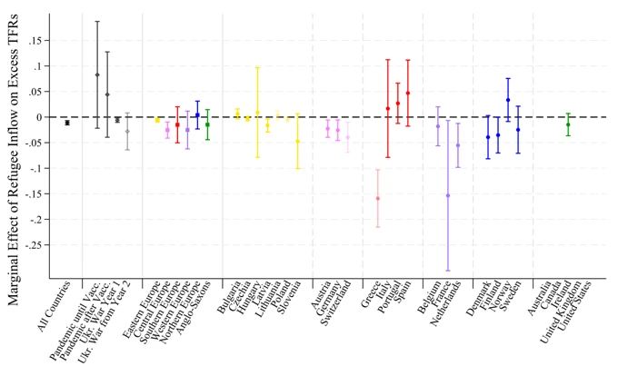
Enlarge ↗
</a>
<a class="media-source" href="https://doi.org/10.1111/padr.70091" target="_blank" rel="noopener noreferrer">Source</a>
</figure>
<figure class="media-card paper-visual" id="polycrisis-figure-10">
<figcaption class="visual-title">Figure 10. Association of economic policy uncertainty index with excess TFRs during the COVID-19 pandemic and second polycrisis phase</figcaption>
<a class="enlarge-image" href="assets/papers/polycrisis/figure-10.png" data-caption="Figure 10. Association of economic policy uncertainty index with excess TFRs during the COVID-19 pandemic and second polycrisis phase" aria-label="Enlarge: Figure 10. Association of economic policy uncertainty index with excess TFRs during the COVID-19 pandemic and second polycrisis phase">
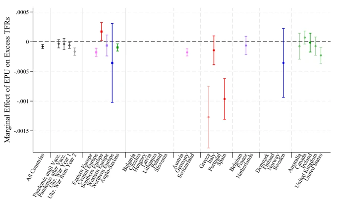
Enlarge ↗
</a>
<a class="media-source" href="https://doi.org/10.1111/padr.70091" target="_blank" rel="noopener noreferrer">Source</a>
</figure>
<figure class="media-card paper-visual" id="polycrisis-figure-11">
<figcaption class="visual-title">Figure 11. Association of geopolitical risk index with excess TFRs during the COVID-19 pandemic and second polycrisis phase</figcaption>
<a class="enlarge-image" href="assets/papers/polycrisis/figure-11.png" data-caption="Figure 11. Association of geopolitical risk index with excess TFRs during the COVID-19 pandemic and second polycrisis phase" aria-label="Enlarge: Figure 11. Association of geopolitical risk index with excess TFRs during the COVID-19 pandemic and second polycrisis phase">
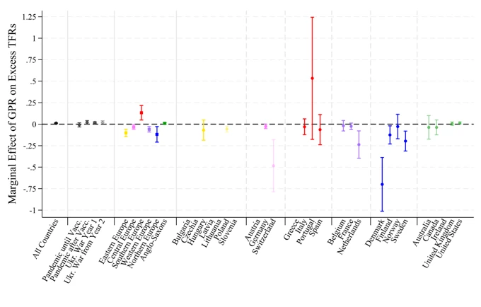
Enlarge ↗
</a>
<a class="media-source" href="https://doi.org/10.1111/padr.70091" target="_blank" rel="noopener noreferrer">Source</a>
</figure>
<figure class="media-card paper-visual" id="polycrisis-table-2">
<figcaption class="visual-title">Table 2. Overall explained excess TFRs relative to the trend (in %): “Real magnitudes” as actual variation in rates of explanatory variables · marginal “effects” compared to observed excess TFRs</figcaption>
<a class="enlarge-image" href="assets/papers/polycrisis/table-2.png" data-caption="Table 2. Overall explained excess TFRs relative to the trend (in %): “Real magnitudes” as actual variation in rates of explanatory variables · marginal “effects” compared to observed excess TFRs" aria-label="Enlarge: Table 2. Overall explained excess TFRs relative to the trend (in %): “Real magnitudes” as actual variation in rates of explanatory variables · marginal “effects” compared to observed excess TFRs">
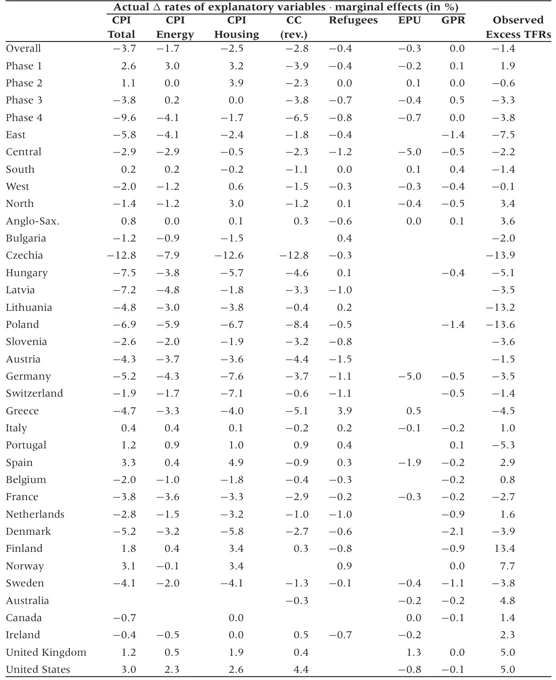
Enlarge ↗
</a>

NOTE: For data availability, refer to the Data section and to Table 1. For estimated coefficients, refer to Figures 5–11. Higher level, aggregated “real magnitudes” do not reflect (weighted) averages of lower level “real magnitudes” as underlying coefficients are estimated using between- and within-variation instead of only within variation. Actual variation in rates of explanatory variables is the actual rates during the polycrisis minus the rate in the 12 months before the polycrisis.

<a class="media-source" href="https://doi.org/10.1111/padr.70091" target="_blank" rel="noopener noreferrer">Source</a>
</figure>

:::

::: {.publication}
::: {.pub-year}
2026
:::

#### [Parenthood Decisions in Uncertain Times: Experimental Evidence from Four Countries](https://doi.org/10.1073/pnas.2601690123)

Aassve, A., L. Mencarini, C. Peng, **S. Plach**, A. R. Amarales, M. L. Tanturri.

*Proceedings of the National Academy of Sciences, 123 (31), e2601690123*.

Abstract

Fertility rates are declining across much of the globe, yet the forces driving this decline have become increasingly complex, and classic theories have become less adequate to explain recent trends. While economic and gender-related explanations have long dominated fertility research, emerging global uncertainties, such as climate change, democratic backsliding, economic crises, and regional conflicts, may also shape how individuals evaluate childbearing. In addition to the more classical factors, this cross-national study examines how macrolevel uncertainties influence perceptions of fertility intentions in Italy, Argentina, the United States, and Germany. These countries offer distinct fertility trajectories and face unique combinations of sociopolitical and environmental challenges. Using a conjoint experiment, we examine how individuals evaluate, across hypothetical scenarios, their intention of having a child under varying household, policy, and macrolevel conditions. Across all four countries, material security remains central: household income is the strongest predictor of fertility intentions, with homeownership and childcare playing smaller roles. At the same time, perceptions of macrolevel stability, including expectations about climate conditions, economic prospects, democratic functioning, and peace, exert substantial and meaningful effects, comparable to homeownership and childcare provision but more pronounced than those associated with gender-role arrangements. Cross-country differences show that macroeconomic stability and climate change are most consequential in Argentina, while in the United States respondents are less responsive to geopolitical conflict. These findings show that individuals evaluate childbearing not only through their immediate circumstances, but also through expectations about broader societal futures, highlighting the importance of incorporating macrolevel uncertainty when explaining contemporary fertility decline.

[Source](https://doi.org/10.1073/pnas.2601690123)

Figures and table from the last submitted manuscript.

<figure class="media-card paper-visual" id="parenthood-figure-1">
<figcaption class="visual-title">Figure 1. Average marginal component effects on fertility intentions, by country (ratings)</figcaption>
<a class="enlarge-image" href="assets/papers/parenthood/figure-1.png" data-caption="Figure 1. Average marginal component effects on fertility intentions, by country (ratings)" aria-label="Enlarge: Figure 1. Average marginal component effects on fertility intentions, by country (ratings)">
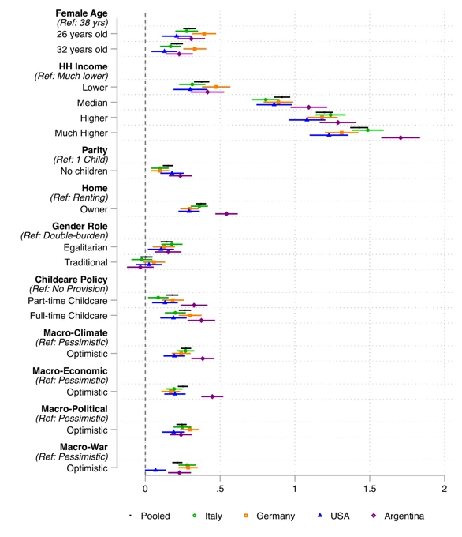
Enlarge ↗
</a>

Notes: Estimates from linear models with respondent fixed effects, country fixed effects in pooled models, vignette order fixed effects, and position fixed effects. Outcome is a 1 to 10 rating of intention to have a child within three years. Standard errors are clustered by respondent.

<a class="media-source" href="https://doi.org/10.1073/pnas.2601690123" target="_blank" rel="noopener noreferrer">Article · visuals: submitted manuscript</a>
</figure>
<figure class="media-card paper-visual" id="parenthood-figure-2">
<figcaption class="visual-title">Figure 2. Income-equivalent trade-offs, as a share of median income and in PPP-adjusted international dollars</figcaption>
<a class="enlarge-image" href="assets/papers/parenthood/figure-2.png" data-caption="Figure 2. Income-equivalent trade-offs, as a share of median income and in PPP-adjusted international dollars" aria-label="Enlarge: Figure 2. Income-equivalent trade-offs, as a share of median income and in PPP-adjusted international dollars">
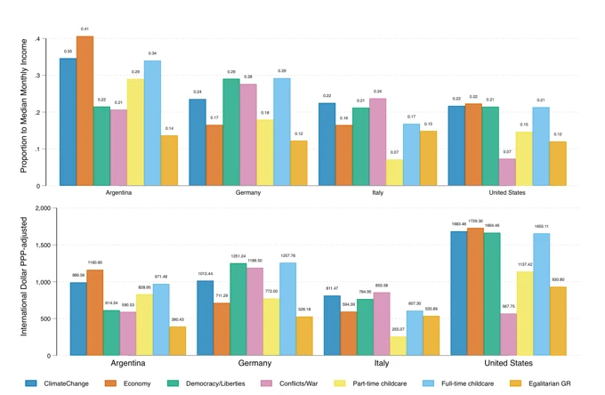
Enlarge ↗
</a>

Notes: Income-equivalent trade-offs are computed by dividing the coefficient of each policy-support and macro stability factor by the coefficient of income, treating the income factor as continuous. In the upper panel, values are expressed as shares of median monthly income. In the lower panel, values are expressed as monthly income in PPP-adjusted international dollars.

<a class="media-source" href="https://doi.org/10.1073/pnas.2601690123" target="_blank" rel="noopener noreferrer">Article · visuals: submitted manuscript</a>
</figure>
<figure class="media-card paper-visual" id="parenthood-table-1">
<figcaption class="visual-title">Table 1. Descriptive statistics of the sample by country</figcaption>
<a class="enlarge-image" href="assets/papers/parenthood/table-1.png" data-caption="Table 1. Descriptive statistics of the sample by country" aria-label="Enlarge: Table 1. Descriptive statistics of the sample by country">
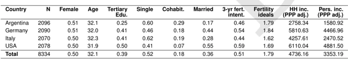
Enlarge ↗
</a>
<a class="media-source" href="https://doi.org/10.1073/pnas.2601690123" target="_blank" rel="noopener noreferrer">Article · visuals: submitted manuscript</a>
</figure>

:::

::: {.publication}
::: {.pub-year}
2024
:::

#### [Family Ideals in an Era of Low Fertility](https://doi.org/10.1073/pnas.2311847121)

Aassve, A., A. Adserà, P. Y. Chang, L. Mencarini, H. Park, C. Peng, **S. Plach**, J. M. Raymo, S. Wang, J. Yeung Wei-Jun.

*Proceedings of the National Academy of Sciences, 121 (6)*.

Abstract

Taking stock of individuals’ perceived family ideals is particularly important in the current moment given unprecedented fertility declines and the diversification of households in advanced industrial societies. Study participants in urban China, Japan, South Korea, Singapore, the United States, Italy, Spain, and Norway were asked to evaluate vignettes describing families whose characteristics vary on ten dimensions. In contrast to previous studies that focused on a single dimension, such as fertility ideals or gender roles, this holistic vignette approach identifies the relative importance of each dimension. Multilevel regression analysis reveals both expected and unexpected findings. Parenthood remains a positive ideal, but the number of children does not matter once other family dimensions are considered, a potentially important finding in light of conventional wisdom regarding the two-children ideal. When evaluating families with at least one child, respondents tend to positively evaluate more traditional arrangements, including valuing marriage relative to cohabitation and, particularly, divorce. Also, in addition to financial resources, good communication between immediate and extended family members, as well as maintaining respect in the larger community, are highly salient attributes of an ideal family. Notwithstanding some important cross-national differences, egalitarian gender roles and avoiding work–family conflict are also valued positively. Overall, even as the study reveals some notable variations between societies, respondents across countries identify similar components of an ideal family.

[Source](https://pmc.ncbi.nlm.nih.gov/articles/PMC10861923/)

<figure class="media-card paper-visual" id="ideals-figure-1">
<figcaption class="visual-title">Figure 1. Family ideals pooled sample—Experiment 1 (incl. “no children”).</figcaption>
<a class="enlarge-image" href="assets/papers/ideals/figure-1.png" data-caption="Figure 1. Family ideals pooled sample—Experiment 1 (incl. “no children”)." aria-label="Enlarge: Figure 1. Family ideals pooled sample—Experiment 1 (incl. “no children”).">
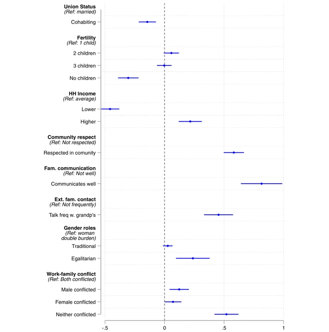
Enlarge ↗
</a>
<a class="media-source" href="https://doi.org/10.1073/pnas.2311847121" target="_blank" rel="noopener noreferrer">Source</a>
</figure>
<figure class="media-card paper-visual" id="ideals-figure-2">
<figcaption class="visual-title">Figure 2. Family ideals pooled sample—Experiment 2 (excl. “no children”).</figcaption>
<a class="enlarge-image" href="assets/papers/ideals/figure-2.png" data-caption="Figure 2. Family ideals pooled sample—Experiment 2 (excl. “no children”)." aria-label="Enlarge: Figure 2. Family ideals pooled sample—Experiment 2 (excl. “no children”).">
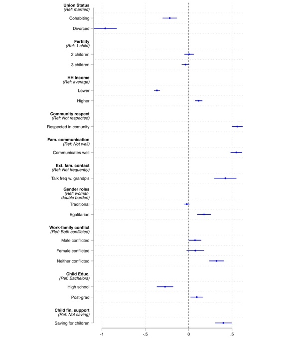
Enlarge ↗
</a>
<a class="media-source" href="https://doi.org/10.1073/pnas.2311847121" target="_blank" rel="noopener noreferrer">Source</a>
</figure>
<figure class="media-card paper-visual" id="ideals-figure-3">
<figcaption class="visual-title">Figure 3. Family ideals by country—Experiment 1 (incl. “no children”).</figcaption>
<a class="enlarge-image" href="assets/papers/ideals/figure-3.png" data-caption="Figure 3. Family ideals by country—Experiment 1 (incl. “no children”)." aria-label="Enlarge: Figure 3. Family ideals by country—Experiment 1 (incl. “no children”).">
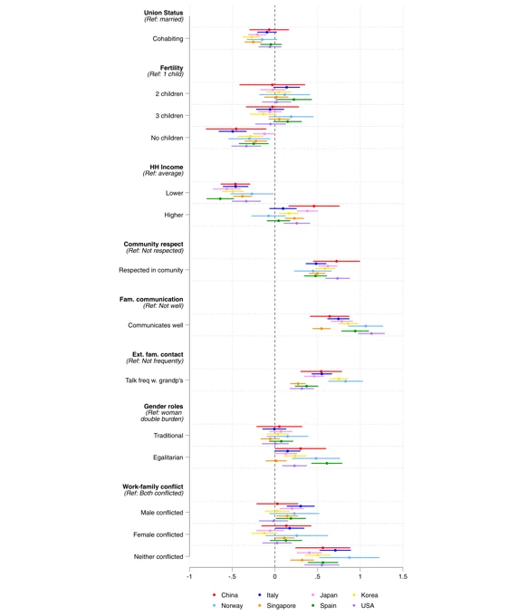
Enlarge ↗
</a>
<a class="media-source" href="https://doi.org/10.1073/pnas.2311847121" target="_blank" rel="noopener noreferrer">Source</a>
</figure>
<figure class="media-card paper-visual" id="ideals-figure-4">
<figcaption class="visual-title">Figure 4. Family ideals by country—Experiment 2 (excl. “no children”).</figcaption>
<a class="enlarge-image" href="assets/papers/ideals/figure-4.png" data-caption="Figure 4. Family ideals by country—Experiment 2 (excl. “no children”)." aria-label="Enlarge: Figure 4. Family ideals by country—Experiment 2 (excl. “no children”).">
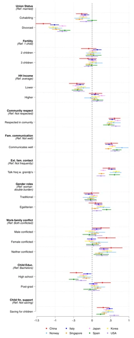
Enlarge ↗
</a>
<a class="media-source" href="https://doi.org/10.1073/pnas.2311847121" target="_blank" rel="noopener noreferrer">Source</a>
</figure>
<figure class="media-card paper-visual" id="ideals-table-1">
<figcaption class="visual-title">Table 1. Vignette factors and levels</figcaption>
<a class="enlarge-image" href="assets/papers/ideals/table-1.png" data-caption="Table 1. Vignette factors and levels" aria-label="Enlarge: Table 1. Vignette factors and levels">
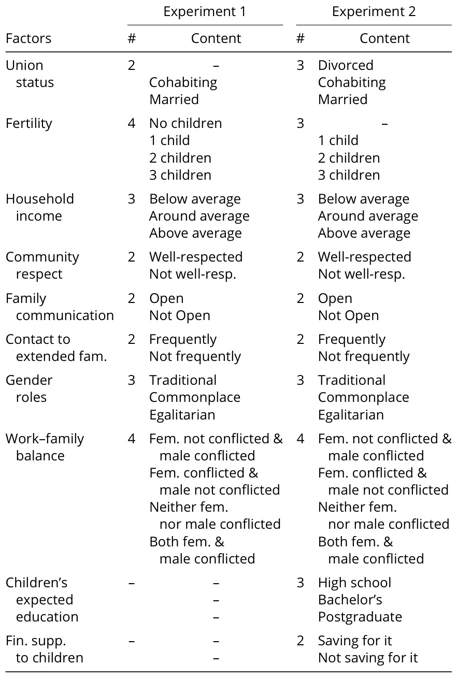
Enlarge ↗
</a>
<a class="media-source" href="https://doi.org/10.1073/pnas.2311847121" target="_blank" rel="noopener noreferrer">Source</a>
</figure>

:::

::: {.publication}
::: {.pub-year}
2023
:::

#### [COVID-19 policy interventions and fertility dynamics in the context of pre-pandemic welfare support](https://doi.org/10.1111/padr.12557)

**Plach, S.**, A. Aassve, N. Cavalli, L. Mencarini, S. Sanders.

*Population and Development Review, 50(S1): 363–393*.

Abstract

This paper focuses on nonpharmaceutical interventions (NPIs) to explain fertility dynamics during the pandemic, while considering countries’ institutional context. We argue that containment policies disrupted people's lives and increased their uncertainty more in countries with weak welfare support systems, while health-related and economic support NPIs mitigated such disruptions much more there, as they were less expected by citizens. We estimate monthly “excess” crude birth rates (CBRs) and find that countries with low public support—Southern Europe, East Asia, and Eastern Europe—experienced larger decreases and less of a rebound in CBRs than countries with histories of high public spending—Western, Central, and Northern Europe. However, in low support countries, NPIs are much more strongly associated with excess CBRs—containment NPIs more negatively and health and economic support NPIs more positively—with the exception of the one-month lag of containment NPIs, for which the opposite holds. When putting these coefficients into broader perspective, our findings suggest that the actual implementation of all NPIs taken together mitigated fertility declines. This is especially the case for low public support countries, whereas one might have seen a birth decline even in high support countries if the NPIs were not implemented.

[Source](https://doi.org/10.1111/padr.12557)

<figure class="media-card paper-visual" id="policy-table-1">
<figcaption class="visual-title">Table 1. Description of the single NPIs used to calculate the containment and closure, health, and economic support indices</figcaption>
<a class="enlarge-image" href="assets/papers/policy/table-1.png" data-caption="Table 1. Description of the single NPIs used to calculate the containment and closure, health, and economic support indices" aria-label="Enlarge: Table 1. Description of the single NPIs used to calculate the containment and closure, health, and economic support indices">
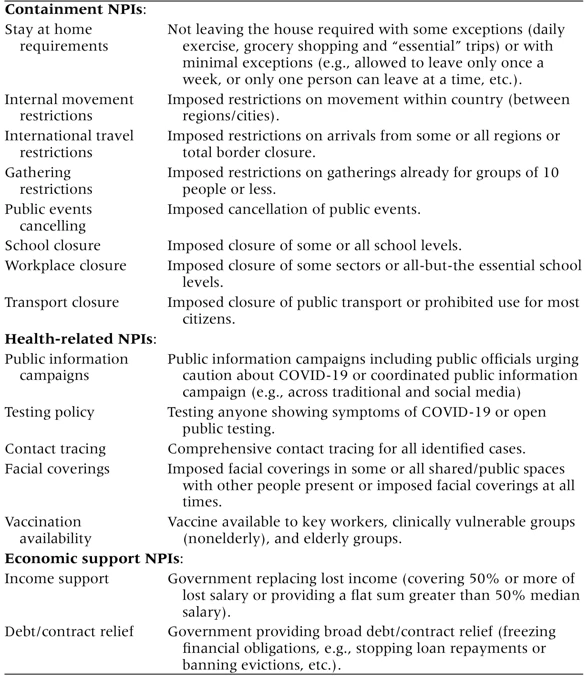
Enlarge ↗
</a>
<a class="media-source" href="https://doi.org/10.1111/padr.12557" target="_blank" rel="noopener noreferrer">Source</a>
</figure>
<figure class="media-card paper-visual" id="policy-figure-1">
<figcaption class="visual-title">Figure 1. CBRs relative to the average in the respective month in the five years before the pandemic for selected countries</figcaption>
<a class="enlarge-image" href="assets/papers/policy/figure-1.png" data-caption="Figure 1. CBRs relative to the average in the respective month in the five years before the pandemic for selected countries" aria-label="Enlarge: Figure 1. CBRs relative to the average in the respective month in the five years before the pandemic for selected countries">
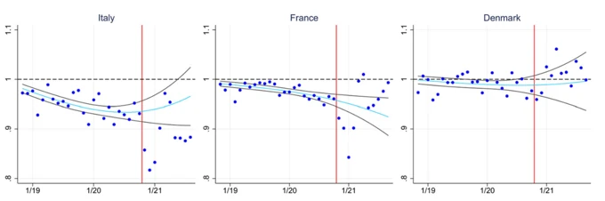
Enlarge ↗
</a>

NOTE: CBRs as a ratio to the mean for the respective month in November 2015 to October 2020. The red vertical line is the pandemic cutoff for births (between October and November 2020). Time trends (fitted light blue lines) are estimated based on the OLS model: relCBRc,t = ∑i=13 γi ti + εc,t on data from November 2015 until the most recent observation of birth data by country. Excess CBRs are the difference between actual CBRs and the trend as a ratio to the trend, i.e. the percentage deviation of CBRs from the trend.

<a class="media-source" href="https://doi.org/10.1111/padr.12557" target="_blank" rel="noopener noreferrer">Source</a>
</figure>
<figure class="media-card paper-visual" id="policy-table-2-part-1">
<figcaption class="visual-title">Table 2. Mean excess CBRs during the pandemic, and public social expenditure and institutional trust before the pandemic by country (part 1 of 2)</figcaption>
<a class="enlarge-image" href="assets/papers/policy/table-2-part-1.png" data-caption="Table 2. Mean excess CBRs during the pandemic, and public social expenditure and institutional trust before the pandemic by country (part 1 of 2)" aria-label="Enlarge: Table 2. Mean excess CBRs during the pandemic, and public social expenditure and institutional trust before the pandemic by country (part 1 of 2)">
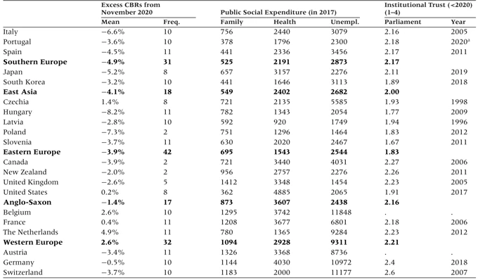
Enlarge ↗
</a>
<a class="media-source" href="https://doi.org/10.1111/padr.12557" target="_blank" rel="noopener noreferrer">Source</a>
</figure>
<figure class="media-card paper-visual" id="policy-table-2-part-2">
<figcaption class="visual-title">Table 2. Mean excess CBRs during the pandemic, and public social expenditure and institutional trust before the pandemic by country (part 2 of 2)</figcaption>
<a class="enlarge-image" href="assets/papers/policy/table-2-part-2.png" data-caption="Table 2. Mean excess CBRs during the pandemic, and public social expenditure and institutional trust before the pandemic by country (part 2 of 2)" aria-label="Enlarge: Table 2. Mean excess CBRs during the pandemic, and public social expenditure and institutional trust before the pandemic by country (part 2 of 2)">
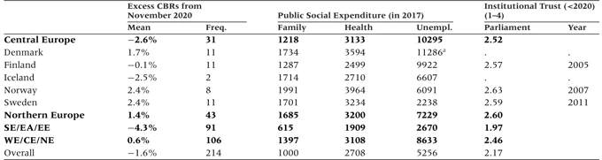
Enlarge ↗
</a>

NOTE: SE/EA/EE refers to Southern Europe, East-Asia, and Eastern Europe (low pre-pandemic public support), while WE/CE/NE refers to Western, Central, and Northern Europe (high pre-pandemic public support). Excess CBRs refer to the difference between the actual CBR and the estimated trend divided by the trend by month. CBRs are first put into relation to the mean for the respective month in the five years before the pandemic to account for seasonality. Means by country-groups for excess CBRs are weighted by country-months of available live birth data during the pandemic. (The means for public social expenditure and trust are not weighted.) CBR data for the United Kingdom include only data for England and Wales (Human Fertility Database 2022). Social Expenditure for family is per head, at constant prices (2015) and constant PPPs (2015), in USD (OECD 2022b). For unemployment, this is divided by the unemployment rate (OECD 2022c; Eurostat 2022), which results in an approximate measure of unemployment support per unemployed person (this multiplied by ratio of labor force to total population). Data on institutional trust come from the most recent World Value Survey (WVS) wave by country (Haerpfer et al. 2021). It is measured on a 4-point Likert scale (1 = Not at all, 2 = Not very much, 3 = Quite a lot, 4 = A great deal). a. The social expenditure on unemployment for Denmark includes voluntary unemployment insurance, that is, private expenditure and is calculated from official country sources (Statistics Denmark 2022) and OECD PPP data (OECD 2022a).

<a class="media-source" href="https://doi.org/10.1111/padr.12557" target="_blank" rel="noopener noreferrer">Source</a>
</figure>
<figure class="media-card paper-visual" id="policy-figure-2">
<figcaption class="visual-title">Figure 2. CBRs relative to the average in the respective month in the five years before the pandemic for low and high welfare spending countries from November 2018 to August 2021</figcaption>
<a class="enlarge-image" href="assets/papers/policy/figure-2.png" data-caption="Figure 2. CBRs relative to the average in the respective month in the five years before the pandemic for low and high welfare spending countries from November 2018 to August 2021" aria-label="Enlarge: Figure 2. CBRs relative to the average in the respective month in the five years before the pandemic for low and high welfare spending countries from November 2018 to August 2021">
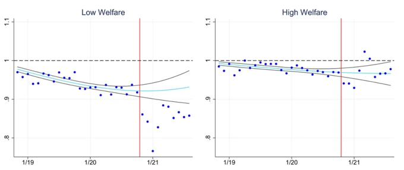
Enlarge ↗
</a>

NOTE: CBRs as a ratio to the mean for the respective month in November 2015 to October 2020. The red vertical line is the pandemic cutoff for births (between October and November 2020). Time trends (fitted light blue lines) are estimated based on the OLS model: relCBRc,t = ∑i=13 γi ti + εc,t on data from November 2015 until the most recent observation of birth data by welfare group. Excess CBRs are the difference between actual CBRs and the trend as a ratio to the trend, i.e. the percentage deviation of CBRs from the trend. The seasonally adjusted monthly CBRs and the trend are presented as population weighted averages across countries in each of the groups. Low welfare refers to Southern Europe, East-Asia, and Eastern Europe, while high welfare refers to Western, Central, and Northern Europe.

<a class="media-source" href="https://doi.org/10.1111/padr.12557" target="_blank" rel="noopener noreferrer">Source</a>
</figure>
<figure class="media-card paper-visual" id="policy-figure-3">
<figcaption class="visual-title">Figure 3. Nonpharmaceutical interventions over time by country groups</figcaption>
<a class="enlarge-image" href="assets/papers/policy/figure-3.png" data-caption="Figure 3. Nonpharmaceutical interventions over time by country groups" aria-label="Enlarge: Figure 3. Nonpharmaceutical interventions over time by country groups">
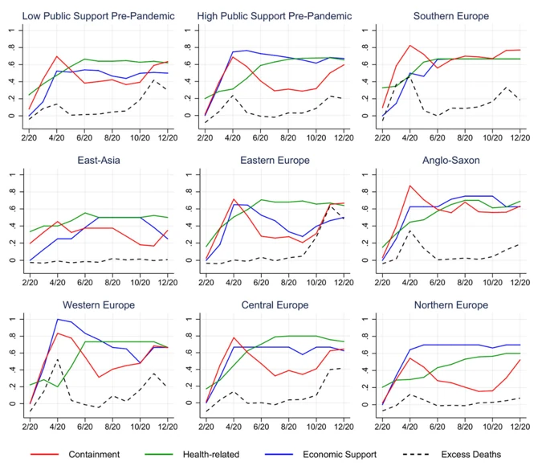
Enlarge ↗
</a>

NOTE: The NPI indices refer to the monthly mean implementation rate calculated from the daily mean implementation of the single NPIs. The monthly implementation rate by country is aggregated to different groups of countries. The indices are containment and closure (stay-at home requirements; internal movement restrictions; international travel restrictions; private gathering restrictions; public events cancellations; school closures; workplace closures; public transport closures); health-related (public information campaigns, testing policies; contact tracing; facial coverings, vaccine availability); and economic support (income support; debt/contract relief). An implementation rate of 1 would indicate the implementation of all NPIs for the respective index on all days of the month in all countries in the respective group. Low public support pre-pandemic refers to Southern Europe, East-Asia, and Eastern Europe, while high public support pre-pandemic refers to Western, Central, and Northern Europe. The respective countries comprising each country-group are listed in Table 2.

<a class="media-source" href="https://doi.org/10.1111/padr.12557" target="_blank" rel="noopener noreferrer">Source</a>
</figure>
<figure class="media-card paper-visual" id="policy-figure-4">
<figcaption class="visual-title">Figure 4. The relationship between NPIs and excess CBRs overall and by low versus high public support before the pandemic</figcaption>
<a class="enlarge-image" href="assets/papers/policy/figure-4.png" data-caption="Figure 4. The relationship between NPIs and excess CBRs overall and by low versus high public support before the pandemic" aria-label="Enlarge: Figure 4. The relationship between NPIs and excess CBRs overall and by low versus high public support before the pandemic">
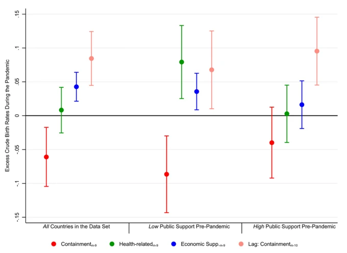
Enlarge ↗
</a>

NOTE: Excess CBRs refer to the difference between the actual CBR and the estimated trend divided by the trend by month, representing the percentage deviation of CBRs from the trend by month. CBRs are first put into relation to the mean for the respective month in the five years before the pandemic to account for seasonality. The group of countries with low public support before the pandemic includes southern European, East Asian, and eastern European countries, while the one with high public support before the pandemic includes western, central, and northern European countries.

<a class="media-source" href="https://doi.org/10.1111/padr.12557" target="_blank" rel="noopener noreferrer">Source</a>
</figure>
<figure class="media-card paper-visual" id="policy-figure-5">
<figcaption class="visual-title">Figure 5. The relationship between NPIs and excess CBRs by groups of countries</figcaption>
<a class="enlarge-image" href="assets/papers/policy/figure-5.png" data-caption="Figure 5. The relationship between NPIs and excess CBRs by groups of countries" aria-label="Enlarge: Figure 5. The relationship between NPIs and excess CBRs by groups of countries">
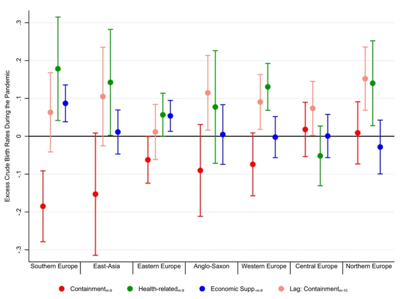
Enlarge ↗
</a>

NOTE: Excess CBRs refer to the difference between the actual CBR and the estimated trend divided by the trend by month, representing the percentage deviation of CBRs from the trend by month. CBRs are first put into relation to the mean for the respective month in the five years before the pandemic to account for seasonality. The respective countries comprising each country-group are listed in Table 2.

<a class="media-source" href="https://doi.org/10.1111/padr.12557" target="_blank" rel="noopener noreferrer">Source</a>
</figure>
<figure class="media-card paper-visual" id="policy-figure-6">
<figcaption class="visual-title">Figure 6. Excess CBRs by low versus high pre-pandemic public support and country-groups, both without and with controlling for excess deaths and NPIs</figcaption>
<a class="enlarge-image" href="assets/papers/policy/figure-6.png" data-caption="Figure 6. Excess CBRs by low versus high pre-pandemic public support and country-groups, both without and with controlling for excess deaths and NPIs" aria-label="Enlarge: Figure 6. Excess CBRs by low versus high pre-pandemic public support and country-groups, both without and with controlling for excess deaths and NPIs">
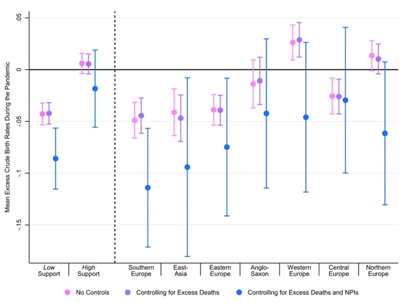
Enlarge ↗
</a>

NOTE: Pink, violet, and light blue dots (and corresponding 95% CIs) refer to the coefficients on country-group dummies in the model with, respectively, solely country-group dummies; country-group dummies and excess deaths; and country-group dummies, excess deaths, NPI implementation rate indices, and interactions between NPI indices and country-groups (our full model). An alternative method is shown in Table B1 in Appendix B.4 (in the Supporting Information). Here we multiply the coefficients from Figures 4 and 5 with the actual mean monthly NPI implementation rates by country-groups (illustrated in Figure 3).

<a class="media-source" href="https://doi.org/10.1111/padr.12557" target="_blank" rel="noopener noreferrer">Source</a>
</figure>

:::

::: {.publication}
::: {.pub-year}
2022
:::

#### [The association between COVID-19 policy responses and mental well-being: Evidence from 28 European countries](https://doi.org/10.1016/j.socscimed.2022.114906)

Toffolutti, V., **S. Plach**, T. Maksimovic, G. Piccitto, M. Mascherini, L. Mencarini, A. Aassve.

*Social Science & Medicine, 114906*.

Abstract

This study assesses how the implementation and lifting of non-pharmaceutical policy interventions (NPIs), deployed by most governments, to curb the COVID-19 pandemic, were associated with individuals’ mental well-being (MWB) across 28 European countries. This is done both for the general population and across key-groups. We analyze longitudinal data for 15,147 respondents from three waves of the Eurofound-“Living, Working and COVID-19” survey, covering the period April 2020–March 2021. MWB is measured by the WHO-5 index. Our evidence suggests that restriction on international travel, private gatherings, and contact tracing (workplace closures) were negatively (positively) associated with MWB by about, respectively, −0.63 [95% CI: −0.79 to −0.47], −0.24 [95% CI: −0.38 to −0.10], and −0.22 [95% CI: −0.36 to −0.08] (0.29 [95% CI: 0.11 to 0.48]) points. These results correspond to −3.9%, −1.5%, and −1.4% (+1.8%) changes compared to pre-pandemic levels. However, these findings mask important group-differences. Women compared to men fared worse under stay-at-home requirements, internal movement restrictions, private gatherings restrictions, public events cancellation, school closures, and workplace closures. Those residing with children below 12, compared to those who do not, fared worse under public events cancellation, school closures and workplace closures. Conversely, those living with children 12–17, compared to those who do not, fared better under internal movement restrictions and public events cancelling. Western-Europeans vis-à-vis Eastern-Europeans fared better under NPIs limiting their mobility and easing their debts, whereas they fared worse under health-related NPIs. This study provides timely evidence of the rise in inequalities during the COVID-19 pandemic and offers strategies for mitigating them.

[Source](https://pmc.ncbi.nlm.nih.gov/articles/PMC8920116/)

<figure class="media-card paper-visual" id="mental-table-1">
<figcaption class="visual-title">Table 1. Description of the NPIs studied here.</figcaption>
<a class="enlarge-image" href="assets/papers/mental/table-1.png" data-caption="Table 1. Description of the NPIs studied here." aria-label="Enlarge: Table 1. Description of the NPIs studied here.">
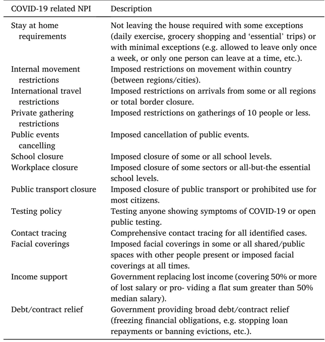
Enlarge ↗
</a>
<a class="media-source" href="https://doi.org/10.1016/j.socscimed.2022.114906" target="_blank" rel="noopener noreferrer">Source</a>
</figure>
<figure class="media-card paper-visual" id="mental-table-2">
<figcaption class="visual-title">Table 2. Descriptive statistics. MWB by key groups.</figcaption>
<a class="enlarge-image" href="assets/papers/mental/table-2.png" data-caption="Table 2. Descriptive statistics. MWB by key groups." aria-label="Enlarge: Table 2. Descriptive statistics. MWB by key groups.">
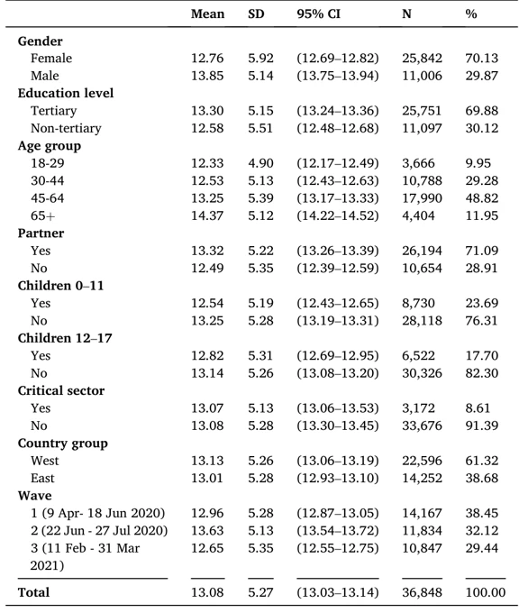
Enlarge ↗
</a>
<a class="media-source" href="https://doi.org/10.1016/j.socscimed.2022.114906" target="_blank" rel="noopener noreferrer">Source</a>
</figure>
<figure class="media-card paper-visual" id="mental-figure-1">
<figcaption class="visual-title">Figure 1. Non-pharmaceutical policy interventions: Cross-country average over time.</figcaption>
<a class="enlarge-image" href="assets/papers/mental/figure-1.png" data-caption="Figure 1. Non-pharmaceutical policy interventions: Cross-country average over time." aria-label="Enlarge: Figure 1. Non-pharmaceutical policy interventions: Cross-country average over time.">
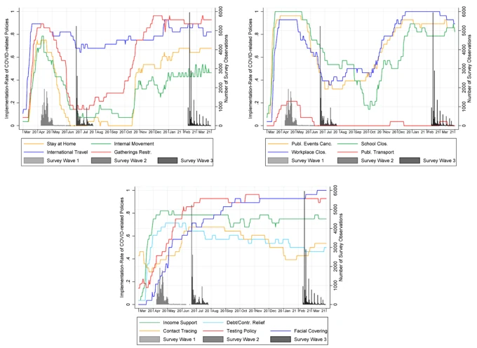
Enlarge ↗
</a>
<a class="media-source" href="https://doi.org/10.1016/j.socscimed.2022.114906" target="_blank" rel="noopener noreferrer">Source</a>
</figure>
<figure class="media-card paper-visual" id="mental-figure-2">
<figcaption class="visual-title">Figure 2. The association of non-pharmaceutical policy interventions with mental well-being.</figcaption>
<a class="enlarge-image" href="assets/papers/mental/figure-2.png" data-caption="Figure 2. The association of non-pharmaceutical policy interventions with mental well-being." aria-label="Enlarge: Figure 2. The association of non-pharmaceutical policy interventions with mental well-being.">
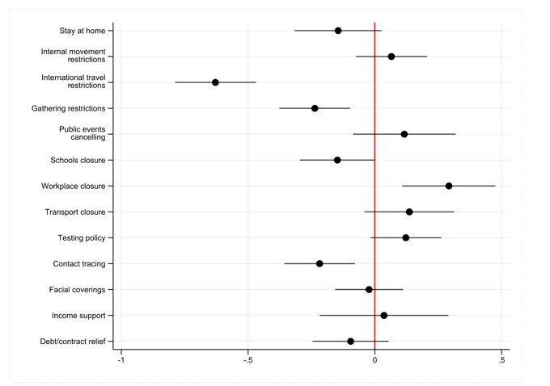
Enlarge ↗
</a>
<a class="media-source" href="https://doi.org/10.1016/j.socscimed.2022.114906" target="_blank" rel="noopener noreferrer">Source</a>
</figure>
<figure class="media-card paper-visual" id="mental-figure-3">
<figcaption class="visual-title">Figure 3. The association of non-pharmaceutical policy interventions with mental well-being: By gender, educational attainment, sector of activity.</figcaption>
<a class="enlarge-image" href="assets/papers/mental/figure-3.png" data-caption="Figure 3. The association of non-pharmaceutical policy interventions with mental well-being: By gender, educational attainment, sector of activity." aria-label="Enlarge: Figure 3. The association of non-pharmaceutical policy interventions with mental well-being: By gender, educational attainment, sector of activity.">
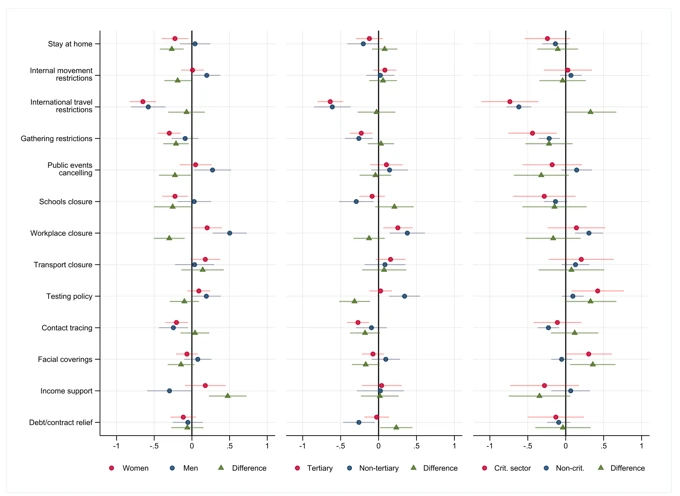
Enlarge ↗
</a>
<a class="media-source" href="https://doi.org/10.1016/j.socscimed.2022.114906" target="_blank" rel="noopener noreferrer">Source</a>
</figure>
<figure class="media-card paper-visual" id="mental-figure-4">
<figcaption class="visual-title">Figure 4. The association of non-pharmaceutical policy interventions with mental well-being: By family arrangements.</figcaption>
<a class="enlarge-image" href="assets/papers/mental/figure-4.png" data-caption="Figure 4. The association of non-pharmaceutical policy interventions with mental well-being: By family arrangements." aria-label="Enlarge: Figure 4. The association of non-pharmaceutical policy interventions with mental well-being: By family arrangements.">
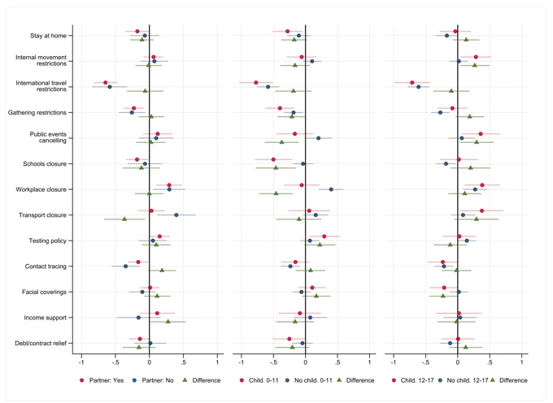
Enlarge ↗
</a>
<a class="media-source" href="https://doi.org/10.1016/j.socscimed.2022.114906" target="_blank" rel="noopener noreferrer">Source</a>
</figure>
<figure class="media-card paper-visual" id="mental-figure-5">
<figcaption class="visual-title">Figure 5. The association of non-pharmaceutical policy interventions with mental well-being: By country group.</figcaption>
<a class="enlarge-image" href="assets/papers/mental/figure-5.png" data-caption="Figure 5. The association of non-pharmaceutical policy interventions with mental well-being: By country group." aria-label="Enlarge: Figure 5. The association of non-pharmaceutical policy interventions with mental well-being: By country group.">
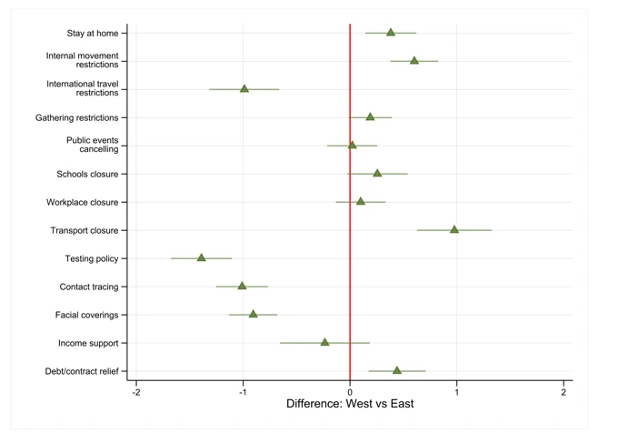
Enlarge ↗
</a>
<a class="media-source" href="https://doi.org/10.1016/j.socscimed.2022.114906" target="_blank" rel="noopener noreferrer">Source</a>
</figure>

:::

::: {.publication}
::: {.pub-year}
2021
:::

#### [Early assessment of the relationship between the COVID-19 pandemic and births in high-income countries](https://doi.org/10.1073/pnas.2105709118)

Aassve, A., N. Cavalli, L. Mencarini, S. **Plach, S.** Sanders.

*Proceedings of the National Academy of Sciences, 118 (36)*.

Abstract

Drawing on past pandemics, scholars have suggested that the COVID-19 pandemic will bring about fertility decline. Evidence from actual birth data has so far been scarce. This brief report uses data on vital statistics from a selection of high-income countries, including the United States. The pandemic has been accompanied by a significant drop in crude birth rates beyond that predicted by past trends in 7 out of the 22 countries considered, with particularly strong declines in southern Europe: Italy (−9.1%), Spain (−8.4%), and Portugal (−6.6%). Substantial heterogeneities are, however, observed.

[Source](https://pmc.ncbi.nlm.nih.gov/articles/PMC8433569/)

<figure class="media-card paper-visual" id="births-table-1">
<figcaption class="visual-title">Table 1. Year-to-year t test comparison for CBRs by country</figcaption>
<a class="enlarge-image" href="assets/papers/births/table-1.png" data-caption="Table 1. Year-to-year t test comparison for CBRs by country" aria-label="Enlarge: Table 1. Year-to-year t test comparison for CBRs by country">
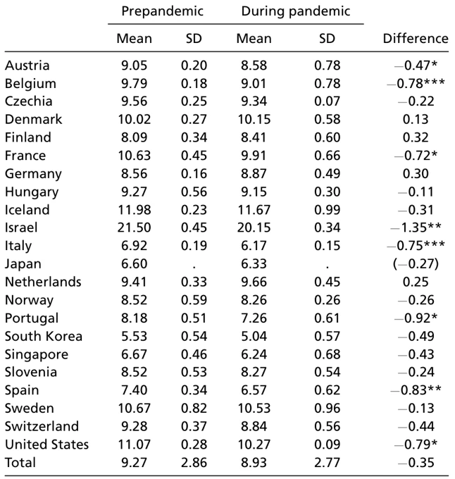
Enlarge ↗
</a>

Pandemic data include CBRs from November 2020 to March 2021 for Denmark, Finland, France, Hungary, The Netherlands, Singapore, Slovenia, Spain, and Sweden; to February 2021 for Germany, Portugal, South Korea, and Switzerland; to January 2021 for Belgium, Israel, and Italy; to December 2020 for Austria, the Czech Republic, Iceland, Norway, and the United States; and to November 2020 for Japan. Prepandemic data include CBRs for corresponding months 1 y before the pandemic. *P &lt; 0.10; **P &lt; 0.05; ***P &lt; 0.01.

<a class="media-source" href="https://doi.org/10.1073/pnas.2105709118" target="_blank" rel="noopener noreferrer">Source</a>
</figure>
<figure class="media-card paper-visual" id="births-figure-1">
<figcaption class="visual-title">Figure 1. Changes in CBRs by country.</figcaption>
<a class="enlarge-image" href="assets/papers/births/figure-1.png" data-caption="Figure 1. Changes in CBRs by country." aria-label="Enlarge: Figure 1. Changes in CBRs by country.">
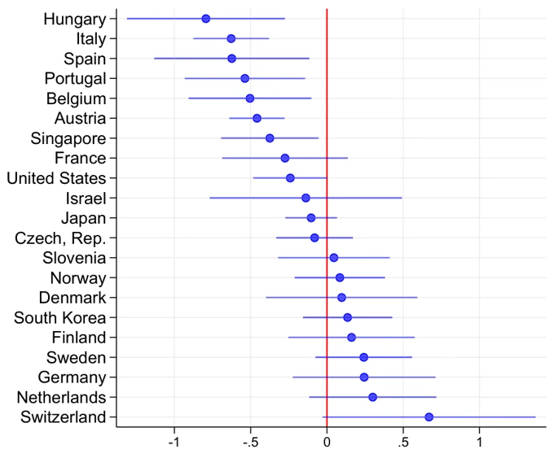
Enlarge ↗
</a>

Shown are point estimates and 95% CIs for within-country models. For illustrative purposes, Iceland (β = −0.61) was excluded due to large CIs (−2.23, 1.01).

<a class="media-source" href="https://doi.org/10.1073/pnas.2105709118" target="_blank" rel="noopener noreferrer">Source</a>
</figure>
<figure class="media-card paper-visual" id="births-figure-2">
<figcaption class="visual-title">Figure 2. CBRs relative to the 2016–2019 average for selected countries.</figcaption>
<a class="enlarge-image" href="assets/papers/births/figure-2.png" data-caption="Figure 2. CBRs relative to the 2016–2019 average for selected countries." aria-label="Enlarge: Figure 2. CBRs relative to the 2016–2019 average for selected countries.">
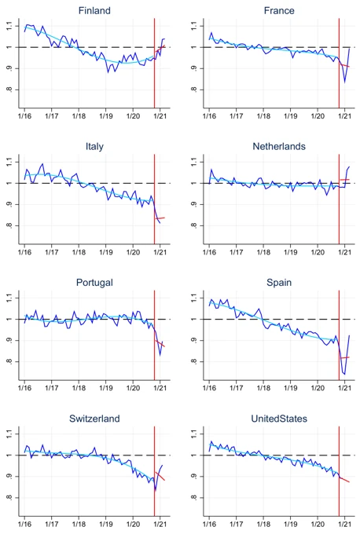
Enlarge ↗
</a>

Shown are CBRs as a ratio to the mean for the respective month in 2016–2019. The red vertical line is the pandemic cutoff for births (November 2020). The dashed black line refers to the CBR in the respective month being equal to the mean for the respective month in 2016–2019. Time trends (fitted light blue and red lines) are estimated based on the OLS model: CBRRatiot = βPandemict + γ1Timet + γ2Timet2 + γ3Timet3 + εt.

<a class="media-source" href="https://doi.org/10.1073/pnas.2105709118" target="_blank" rel="noopener noreferrer">Source</a>
</figure>

:::

::: {.publication}
::: {.pub-year}
2020
:::

#### [The COVID-19 pandemic and human fertility](https://doi.org/10.1126/science.abc9520)

Aassve, A., N. Cavalli, L. Mencarini, **S. Plach**, M. Livi Bacci.

*Science, 369 (6502): 370–371*.

Overview

The coronavirus disease 2019 (COVID-19) pandemic will have consequences for human populations. Worldwide, mortality levels are certainly affected. The worst-hit northern Italian provinces recorded losses of period life expectancy of 2 to 3.5 years for men and 1.1. to 2.5 years for women, the largest decline in life expectancy since the 1918–1919 influenza pandemic and World War II. Similar patterns follow in other countries. With the focus firmly on deaths, the scientific debate risks overlooking that population dynamics are also shaped by fertility trajectories. Throughout history, spikes in mortality owing to events such as wars, famines, and pandemics were followed by changes in fertility, resulting in fewer births in the short term and by recuperation in subsequent years. Economic and social change triggered by a pandemic is also likely to influence childbearing intentions and completed fertility. How the COVID-19 pandemic will affect fertility has implications for the rate of population aging, shaping future health challenges and economic growth potential across the globe.

[Opening paragraph, listed as the abstract in Bocconi’s research repository](https://iris.unibocconi.it/handle/11565/4030260).

<figure class="media-card paper-visual" id="science-figure">
<figcaption class="visual-title">Possible post-pandemic fertility trajectories according to regional income level</figcaption>
<a class="enlarge-image" href="assets/papers/science/figure.png" data-caption="Possible post-pandemic fertility trajectories according to regional income level" aria-label="Enlarge: Possible post-pandemic fertility trajectories according to regional income level">
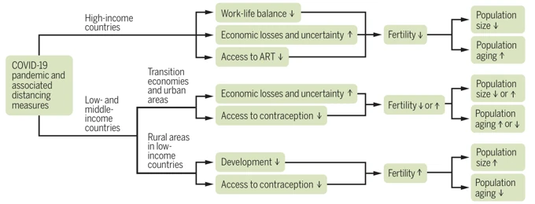
Enlarge ↗
</a>

The social measures aimed at reducing coronavirus disease 2019 (COVID-19) infection may be expected to have different effects on fertility, depending on societies’ development and stage of the demographic transition, and ultimately, on population density and age distribution. ART, assisted reproductive technology. Graphic: H. Bishop/Science.

<a class="media-source" href="https://doi.org/10.1126/science.abc9520" target="_blank" rel="noopener noreferrer">Source</a>
</figure>

:::

### Research assistance

Research assistance on Corno, L., E. La Ferrara, A. Voena (2020). *Female Genital Cutting and the Slave Trade*. CEPR Discussion Paper No. DP15577.
